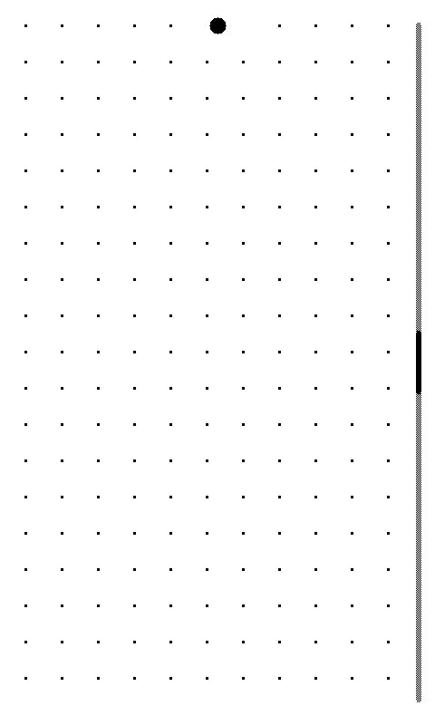
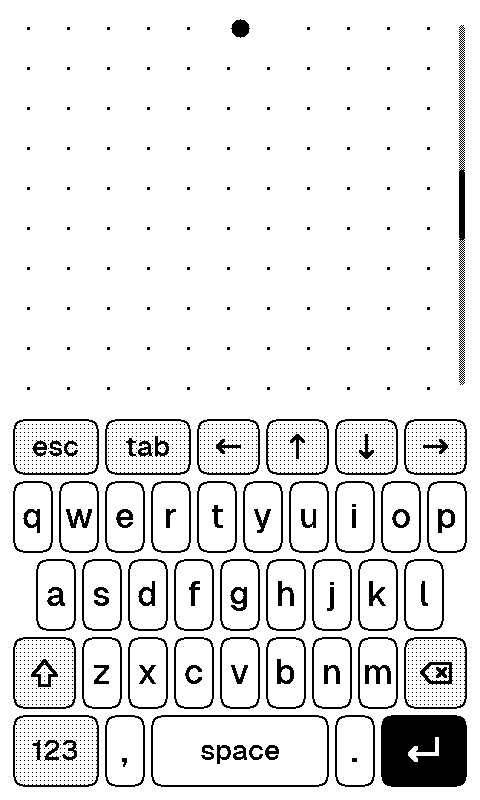
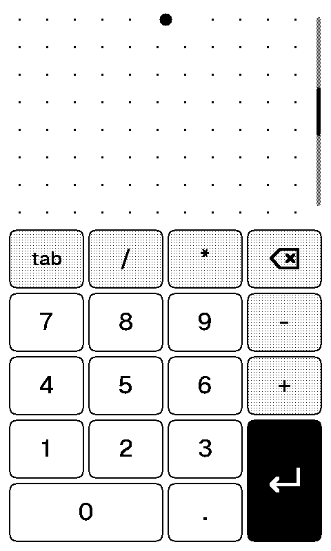
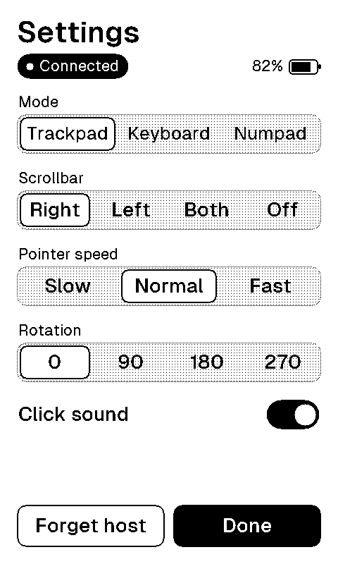
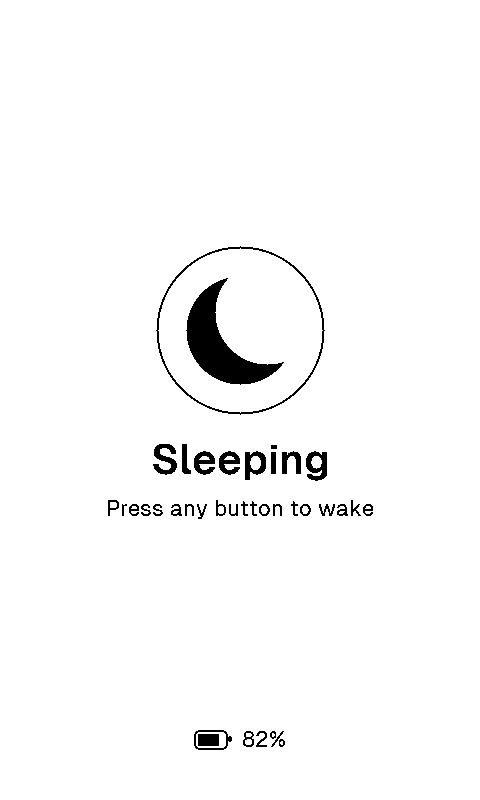

# Sticky Trackpad

A wireless trackpad, keyboard and numpad built on the **Seeed reTerminal Sticky**
(ESP32-S3, 480×800 e-paper, GT911 touch). It pairs over Bluetooth LE as a
standard mouse + keyboard, so it works on any computer with no drivers.

Firmware: `sketches/s13_app/` · Status: **daily-usable prototype** (2026-11-19)

<p>





</p>

*Screens rendered on the host from the same drawing code the device runs
(`tests/test_app_ui.cpp`).*

---

## What it does

| Area | Behavior |
|---|---|
| **Trackpad** | Full-screen dot grid with no text. Status dot at the top: filled = connected, ring = not connected. |
| **Keyboard** | QWERTY + symbol layer, esc/tab/arrow row, with a small trackpad above the keys (portrait). |
| **Numpad** | 4×5 keypad with tab, `/ * - +`, backspace and a tall enter, with a small trackpad above the keys. |
| **Settings** | Hold the status dot for about 0.5 s. Mode, scrollbar side, pointer speed, rotation, click sound, forget host. |
| **Buttons** | OK/power short press = sleep (shows a sleep screen). UP / DOWN = previous / next mode (Trackpad → Keyboard → Numpad). |
| **Sleep** | Full-refresh "Sleeping" screen with battery level stays on the e-paper. Button sleep turns touch off and wakes on any button; idle sleep (10 min, no host) also wakes on touch. |
| **Feedback** | Low, short buzzer ticks (220–520 Hz, far below the buzzer's shrill ~2.7 kHz resonance) for each click type, swipes, keys, connect, disconnect and sleep (can be turned off). |
| **Battery** | Real percentage from the fuel gauge, shown in Settings and reported to the computer over Bluetooth. |
| **Power** | 80 MHz CPU, touch-interrupt wakeups, display asleep between refreshes, BLE slave latency, deep sleep after 10 min with no host. |

## Gestures

| Gesture | Result | Sound |
|---|---|---|
| 1 finger move | Pointer | none |
| Tap | Left click | short tick |
| Tap, tap | Double click | double tick |
| Hold still, or tap then hold | Drag (left button held) | low tone |
| 2 fingers drag | Scroll, both axes | none |
| 2-finger tap | Right click | lower tick |
| 3-finger tap | Middle click | mid tick |
| 3 fingers swipe **left / right** | Next / previous workspace (`Ctrl+Alt+→/←`) | mid tick |
| 3 fingers swipe **up** | Activities overview (`Super`) | chime |
| 3 fingers swipe **down** | `Esc` (close overview) | mid tick |
| Drag along the scrollbar strip | Vertical scroll, scrollbar style (drag down = page down) | none |
| Hold the status dot (about 0.5 s) | Open Settings | chime |

Swipe shortcuts target **Ubuntu GNOME** (the default bindings on the reference Linux host). Other
desktops are listed under [future work](#future-work).

### Keyboard details
- Keys are sent when the finger **lifts**, and several fingers can type at once.
- Backspace and the arrow keys repeat when held (after 420 ms, then every 65 ms).
- Shift: tap once for one capital letter, double-tap for caps lock. `123` / `abc` switches layers.
- Characters are sent as US-layout HID usages. The numpad uses top-row
  digits, so it works whether or not NumLock is on.

## Settings

| Setting | Options | Default |
|---|---|---|
| Mode | Trackpad · Keyboard · Numpad | Trackpad |
| Scrollbar | Right · Left · Both · Off | Right |
| Pointer speed | Slow · Normal · Fast | Normal |
| Rotation | 0 · 90 · 180 · 270 | 0 (USB-C at the bottom) |
| Click sound | on / off | on |
| Forget host | two taps within 5 s | n/a |

Settings are stored in NVS (namespace `sticky13`) and survive reboots and
reflashes. **Done** saves and returns to the main screen with a clean full refresh.

## Pairing

1. On the computer, open Bluetooth settings and pair **Sticky Trackpad** (Just Works, no PIN).
2. The status dot fills in when the device is connected.
3. Bonding is kept across reboots. To move to another computer, use **Settings → Forget host** and pair again.

> If the HID report map changes (it did when the keyboard was added), remove the
> device on the computer **and** use Forget host, then pair again so the host re-reads it.

---

## Measured on hardware

| Metric | Value |
|---|---|
| Touch frame rate (moving finger) | ~95 Hz |
| BLE connection interval / slave latency | 11.25 ms / 8 (accepted by BlueZ) |
| Pointer reports during motion | up to ~94/s |
| Partial refresh (panel) | ~620 ms |
| Full refresh (panel) | ~1.7 s |
| Settings render at 80 MHz | 214 ms (was 475 ms before span-based drawing) |
| SPI frame send | ~100 ms |
| Max simultaneous contacts seen | 4 (GT911 supports 5) |

## Hardware map

| Function | Pins / address | Notes |
|---|---|---|
| Board power hold | GPIO45, GPIO46 high | Held through deep sleep |
| Touch GT911 | I2C0 SDA3 SCL2, INT21, RST41, EN42, `0x5D` | 400 kHz. Logical y = 799 − raw y |
| E-paper SSD1677 | MOSI14 SCK13 CS15 DC16 RST17 BUSY18 EN47 | Panel mounted 90°: SSD(X=y, Y=x) |
| Buzzer | GPIO48 (LEDC) | ~37% duty |
| Fuel gauge BQ27220 | I2C1 SDA1 SCL0, `0x55` | SOC `0x2C`, voltage `0x08` |
| Charger BQ25616 | EN_BAT_CHGn GPIO39 (**drive LOW**), STAT GPIO40 | Without GPIO39 low the battery never charges |
| Buttons | POWER/OK 4, UP 5, DOWN 6 (active low) | OK short press = sleep, UP/DOWN = mode; any button wakes. OK long press left to the power circuit |
| USB-C | CH343P USB-UART only | No native USB HID on the stock port, so Bluetooth is the transport |

Geometry evidence: `docs/GEOMETRY.md`. Schematic: `docs/hardware/`.

## Architecture

```
sketches/s13_app/
  s13_app.ino   app: touch ownership (dot / pad / keys / settings), gestures -> HID,
                key rollover + repeat, settings, power, serial console
  app_ui.h      portable layouts, drawing, hit-testing, US keymap (host-tested)
  gfx.h         1-bit drawing: spans, rounded rects, dithered greys, text, icons
  fonts.h       Geist bitmap fonts (generated, 22 KB)
  hw_epd.h      async full/partial SSD1677 refresh, controller sleep between frames
  hid_ble.h     NimBLE HID mouse (ID 1) + keyboard (ID 2) + battery, link tuning
  hw_misc.h     buzzer sound palette, fuel gauge + charger
sticky_trackpad/
  GestureEngine.h  transport-agnostic gesture engine (v0.3: scrollbar strips)
  MvpUi.h          rotation transforms, tap detector, two-step confirm
sketches/_common/sticky_hw.h  verified touch + display bring-up
```

Design choices:
- **No refresh in the touch path.** The e-paper updates only on discrete state
  changes, and runs asynchronously so touch keeps working while BUSY is high.
- **Session ownership.** Whatever the first finger lands on (dot, pad or keys)
  owns the whole touch until every finger lifts, so typing never moves the
  pointer. A touch that moves off the dot hands over to the trackpad.
- **Portable UI.** Every screen draws through `Gfx`, so it renders to PNG on the
  host for review before it ever reaches the panel.

## Build, test, flash

```sh
FQBN='esp32:esp32:esp32s3:FlashSize=32M,PSRAM=opi,CDCOnBoot=default,USBMode=hwcdc,FlashMode=dio'

# host tests + UI previews (build/previews/_sheet.png)
g++ -std=c++17 -Wall -Wextra -Werror -fsanitize=address,undefined -Isketches/s13_app \
    tests/test_app_ui.cpp -o build/test_app_ui && build/test_app_ui && python3 scripts/previews_to_png.py
g++ -std=c++17 -Wall -Wextra -Werror tests/test_gestures.cpp -o build/test_gestures && build/test_gestures
g++ -std=c++17 -Wall -Wextra -Werror tests/test_mvp_ui.cpp  -o build/test_mvp_ui  && build/test_mvp_ui

# firmware (core 3.3.11, NimBLE-Arduino 2.5.1)
arduino-cli compile --fqbn "$FQBN" --build-path build/s13_app sketches/s13_app
arduino-cli upload  --fqbn "$FQBN" --input-dir build/s13_app -p /dev/ttyACM0 sketches/s13_app
```

Before uploading, positively identify the connected board and confirm that a
usable recovery image is preserved locally. Unique bridge identifiers and
flash dumps stay private and are excluded from this repository.

Fonts are regenerated with:
```sh
python3 scripts/gen_font.py sketches/s13_app/fonts.h \
  geist_sm:assets/fonts/Geist-Regular.ttf:22 geist_body:assets/fonts/Geist-Regular.ttf:26 \
  geist_med:assets/fonts/Geist-Medium.ttf:28 geist_key:assets/fonts/Geist-Medium.ttf:34 \
  geist_title:assets/fonts/Geist-SemiBold.ttf:42
```

### Serial console (115200, `python3 scripts/serial_cmd.py /dev/ttyACM0 10 CMD…`)

| Command | Effect |
|---|---|
| `PING`, `STATUS`, `STATS` | Identity; connection, settings and battery; rates, BLE params, refresh time, heap |
| `MODE n`, `ROT deg` | Switch mode (0 trackpad, 1 keyboard, 2 numpad) / rotation |
| `SCREEN S` / `SCREEN M` | Open settings / return to main |
| `REDRAW`, `FULL` | Partial / full redraw |
| `FORGET` | Delete bonds and advertise |
| `LAT n` | Requested slave latency (next connection) |
| `BEEP`, `SLEEP`, `SLEEPMIN n` | Test sound, button-style sleep now, set idle sleep timeout (0 = never) |

---

## Known limitations

- **Not yet verified on hardware:** waking from deep sleep by touch (ext0 on the
  GT911 INT line), and whether the power hold survives deep sleep. If the board
  powers off instead, the power button starts it again.
- Fuel-gauge current reads implausibly (5750 mA), so charging state comes from the charger STAT pin.
- E-paper feedback is ~0.6–0.9 s per UI change. Key presses use sound, not visual feedback.
- Swipe shortcuts are GNOME-specific.
- The keyboard sends US-layout usages; other host layouts will remap symbols.
- PnP IDs `FFFF:5354` are research placeholders, not an allocated vendor ID.
- No native USB HID on the stock USB-C port (it's wired to the CH343P bridge).

## Future work

**Feel & input**
- Host profiles: GNOME / KDE / Windows / macOS swipe shortcuts, chosen in Settings
  (Windows `Ctrl+Win+←/→`, `Win+Tab`; macOS `Ctrl+←/→`, `Ctrl+↑`).
- Pinch to zoom (`Ctrl` + wheel) and four-finger gestures, now that four contacts are confirmed.
- Two-finger scroll inertia (already in the engine, `tick()`, currently off).
- Tap-to-click / drag-lock / natural-scroll toggles, and live gain tuning from Settings.
- Palm and edge rejection using the GT911 contact size field.
- Multiple saved hosts with a host switcher (for example three slots, like
  Logitech Easy-Switch).

**Keyboard**
- Modifier keys (Ctrl, Alt, Super) and a shortcuts row: copy, paste, undo, screenshot.
- Media keys (volume, play/pause, brightness) through a Consumer Control report.
- **Next big step:** stream-deck mode: a grid of big custom buttons (icons, no text clutter) that send shortcuts, key combos, text snippets or media keys, with several pages switched by UP/DOWN.
- Non-US layouts.

**Display & UI**
- 4-level grayscale for richer UI on full refreshes.
- Faster feedback: send only the changed window to the panel, and use a 20 MHz SPI clock.
- Auto-rotate from the onboard LSM6DS3 IMU.
- A pairing screen with a QR code and help.

**Power**
- Measure real current draw in each state, then tune latency, CPU clock and sleep timeouts.
- Light-sleep build (custom sdkconfig with `CONFIG_PM_ENABLE`) for much lower idle draw.
- Put the GT911 into low-power gesture mode during deep sleep for a reliable touch wake.
- Low-battery chime and a charging indicator on the main screen.

**Platform**
- Native Windows Precision Touchpad (parked port in `sketches/s9_sticky_ptp_ble`).
- USB HID through an added native-USB bridge (hardware mod).
- OTA firmware updates over BLE.
- Use the other onboard sensors: microphone (push-to-talk dictation key),
  temperature/humidity, RTC clock face while idle.

## History

| Sketch | Milestone |
|---|---|
| `touch_probe` | GT911 bring-up: 1–4 simultaneous contacts confirmed |
| `s1`–`s4` | Portrait geometry calibrated end to end |
| `s6` | First BLE HID pointer on a Linux host |
| `s7`, `s8` | Gesture engine port, first GUI |
| `s10`, `s11` | Rate measurement; fast interval (48.75 → 11.25 ms) and 400 kHz touch |
| `s12` | MVP: settings, rotation, side strips |
| **`s13`** | **Product UI (Geist / shadcn style), keyboard + numpad, partial refresh, buzzer, battery, charger fix, power savings, 3-finger swipes** |

---
Fonts: Geist © Vercel, SIL Open Font License 1.1 (`assets/fonts/Geist-OFL.txt`).
